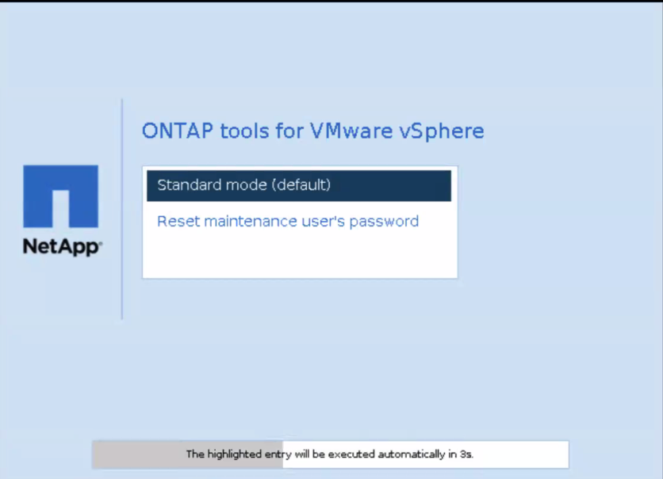

= Redefina a senha do console de manutenção das ONTAP tools
:allow-uri-read: 
:icons: font
:imagesdir: ../media/

[role="lead"]
Durante a reinicialização do sistema operacional convidado, o menu GRUB exibe uma opção para redefinir a senha do usuário do console de manutenção. Use essa opção para atualizar a senha na máquina virtual. Após você redefinir a senha, a máquina virtual será reinicializada. Em uma implantação de alta disponibilidade (HA), o sistema atualiza automaticamente a senha nas outras duas máquinas virtuais após a reinicialização.

NOTE: Para uma implantação HA do ONTAP tools for VMware vSphere, altere a senha do usuário do console de manutenção no nó de gerenciamento do ONTAP tools (node1).

.Passos
. Faça login no vCenter Server
. Clique com o botão direito do mouse na máquina virtual e selecione *Energia* > *Reiniciar SO convidado*. Durante o reinício do sistema, a seguinte tela será exibida: 
+
Você tem cinco segundos para escolher uma opção. Pressione qualquer tecla para interromper a contagem regressiva e pausar o menu GRUB.

. Selecione a opção *Repor a senha do usuário de manutenção*. A consola de manutenção abre-se.
. No console, digite e confirme a nova senha.  Você tem três tentativas.  O sistema reinicia após você inserir a nova senha corretamente.
. Pressione *Enter* para continuar.  O sistema atualiza a senha na máquina virtual.

NOTE: O mesmo menu GRUB aparece quando você liga a máquina virtual. Use a opção de redefinir a senha somente com *Reiniciar Guest OS*.
